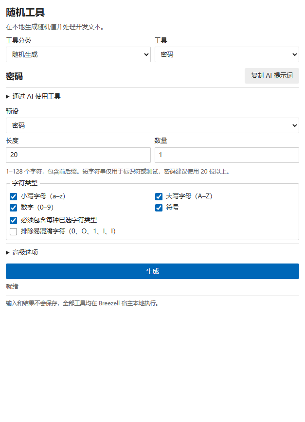

# Random Tools for Breezell

A compact offline panel with nine generation and conversion tools: passwords, JWT HMAC secrets, candidate ports, UUIDs, hashes, timestamps, Base64, URLs and JWT decoding. Inspired by [LDDGO](https://www.lddgo.net/string/randompassword), [JWT Secret Key Generator](https://jwtsecretkeygenerator.com/), and [IT Tools](https://ittoolshq.com/random-port); these sites are not embedded or called by the plugin.

[简体中文](https://github.com/cn-maomao/breezell-random-tools/blob/main/i18n/README.zh-CN.md) · [Source](https://github.com/cn-maomao/breezell-random-tools) · [Releases](https://github.com/cn-maomao/breezell-random-tools/releases) · [Issues](https://github.com/cn-maomao/breezell-random-tools/issues) · [Changelog](https://github.com/cn-maomao/breezell-random-tools/blob/main/CHANGELOG.md) · [MIT license](https://github.com/cn-maomao/breezell-random-tools/blob/main/LICENSE)

Version **0.4.0** uses the plugin identity `cn-maomao.random-tools`, with `cn-maomao` as author and publisher. This is a community plugin, not an official Breezell plugin. GitHub hosting and release downloads do not imply approval or listing in Breezell's plugin market.

## Features

Two dropdowns keep navigation compact: first choose a category, then a tool.



The screenshot uses the actual plugin resources in a local browser preview; the native status-bar shortcut is outside the panel.

| Category | Tools |
|---|---|
| Random generation | Password, Key, Port, UUID |
| Encoding & security | Hash, Base64, JWT decode |
| Parsing & time | URL, Timestamp |

- **Passwords:** length (including fixed prefixes/suffixes), optional length range, uppercase/lowercase/digits, editable special characters, additional and excluded characters, custom-only alphabet, ambiguous-character exclusion, required character categories, and unique batches of 1–100 results. Printable ASCII only; lengths 1–128. The safe default is 20 characters. Short values are for identifiers/testing, not secure passwords.
- **Username preset:** lowercase letters and digits with a letter first. It neither registers accounts nor guarantees availability.
- **Secrets:** cryptographic random bytes encoded as Base64URL, Base64 or Hex. JWT HS256/HS384/HS512 require at least 32/48/64 random bytes. Generic mode accepts 16–128 bytes. This tool does not create API-provider credentials, JWT tokens, or asymmetric key pairs.
- **Ports:** configurable ranges, scenario presets, a finite common-service exclusion list, custom exclusions such as `3000,8080,9000-9010`, and sampling without replacement. Ports are **candidates**, not verified available ports. Service lookup is not a complete IANA registry, a bind test, or a scan. Presets are conventions, not standards. Confirm occupancy and OS restrictions on the target host before use.
- **UUID:** cryptographic UUID v4, standard/compact representations, optional uppercase, batches of 1–100 with no same-batch duplicates. It is not a password.
- **Hash:** UTF-8 text SHA-256/SHA-512/SHA-1/MD5 digests with Hex/Base64 output. MD5 and SHA-1 are for legacy compatibility, not security-sensitive checks or password storage.
- **Timestamp:** seconds/milliseconds to UTC dates, and explicit-timezone ISO 8601 dates to timestamps; rejects invalid dates instead of normalizing them. Fractional Unix seconds are not accepted; seconds output floors negative fractional values.
- **Base64:** encode/decode UTF-8 or hexadecimal bytes in standard/Base64URL form. Strict validation rejects malformed encodings and non-UTF-8 text in text mode. Base64 is encoding, not encryption. No file uploads.
- **URL:** parse absolute HTTP(S) URLs and preserve repeated query parameters; no requests or clickable output. Embedded credentials may appear in the masked result, so treat it as sensitive.
- **JWT:** decode compact three-part JWS header and claims locally. Does not verify signatures, establish validity/authorization, decrypt JWE, or trust an algorithm declared in the input. An empty signature may be decoded but is never marked verified.
- English and Simplified Chinese interface and marketplace metadata. Other interface languages fall back to English.

## Open and use

1. Get the `cn-maomao.random-tools-0.4.0.vsix` asset from the [v0.4.0 GitHub release](https://github.com/cn-maomao/breezell-random-tools/releases/tag/v0.4.0) or build it locally with `npm run package:open`.
2. Install the local VSIX in Breezell's plugin manager and sign in. If you used the earlier `local-tools.random-tools` build, uninstall that old plugin first: the new publisher gives this release a different identity, so it is not an in-place update of the old installation. Keeping both may duplicate commands and status-bar entries.
3. Click the key-icon "Random Tools" shortcut on the right side of the status bar. The plugin's "Open" button, Box launcher and "Random Tools: Open" command are also available.
4. Choose "Tool category" and "Tool", adjust options, then run the selected tool. Changing settings does not overwrite an existing result. Copying a result is always explicit.

Market installation becomes available only after the market submission is reviewed and merged; creating this repository or a GitHub release does not perform that submission.

## Use with AI

The header's "Copy AI prompt" action creates a bilingual tool-call template for the current tool. It writes to the clipboard only when clicked; **you must paste it into a conversation yourself**. The plugin does not send messages automatically or read the chat, editor, or clipboard.

The template copies only validated public numeric options, booleans and enumerated selections. Input text, tokens, generated results, prefixes/suffixes, free-form character sets and free-form port exclusions are omitted. Text tools use a non-sensitive placeholder. Password templates use built-in character defaults and set `customOnly` to `false`; they deliberately do not reproduce custom alphabets.

Enable the `agent.tools` permission and approve the tool as requested by the host. Nine locally registered tools are declared for `chat`, `agent` and `entanglement` modes under MCP server `plugin:cn-maomao.random-tools`; no external MCP process or service is required.

| Tool | Purpose | Result visible to the model |
|---|---|---|
| `rt_password` | Passwords or username-like strings | Metadata and a panel notice only; generated values stay in the panel, including username mode |
| `rt_key` | Random JWT HMAC or generic secret material | Metadata and a panel notice only; generated keys stay in the panel |
| `rt_port` | Candidate port numbers | Numbers and metadata; availability is not checked |
| `rt_uuid` | UUID v4 | UUID values and metadata |
| `rt_hash` | Digest non-sensitive text | Digest and metadata; input also enters the conversation |
| `rt_timestamp` | Convert a timestamp or ISO date | Conversion result and metadata; input also enters the conversation |
| `rt_base64` | Encode/decode non-sensitive text or bytes | Converted content and metadata; input also enters the conversation |
| `rt_url` | Parse a non-sensitive HTTP(S) URL | Parsed fields and metadata, including userinfo; input also enters the conversation |
| `rt_jwt` | Decode a demonstration JWS | Header/claims with `signatureVerified=false` and metadata; input token also enters the conversation |

**Local execution is not the same as model privacy.** All AI tool arguments are visible in the model conversation, including character rules and affixes if you supply them yourself. Except for generated password/key values, tool outputs also enter that conversation and may be sent to the configured model service. Never pass real authentication tokens, passwords, private URLs or other confidential text through AI tool calls. To process those locally without adding them to a model conversation, use the manual panel instead. If tool permission is refused or registration is unavailable, the manual panel remains available while host sign-in and plugin policy allow it.

## Security and privacy

- The only declared Breezell permission is `agent.tools`, used to register the nine optional AI-callable tools and subject to user approval. No chat reading/writing, provider, editor reading, or UI modification permission is requested.
- Manual panel generation and conversion run locally in the Breezell host. The plugin itself makes no runtime network requests and has no telemetry, external processes, file export or history storage. Resources are bundled locally; a strict Webview content-security policy forbids external connections and scripts. AI tool arguments and non-secret outputs are a separate model-conversation data path described above, not a promise that all AI data stays on the computer.
- Passwords use a request-local 4 KiB cryptographic random buffer with unbiased rejection sampling; secrets use `crypto.randomBytes`; ports use uniform sampling. Character alphabets are deduplicated, with no weighting from repeated input and no modulo bias. Required character categories use bounded rejection sampling; impossible or excessively restrictive requests fail instead of relaxing rules.
- Manual inputs/results and AI-generated password/key values are held in panel/extension memory, not saved by the plugin. Closing, reloading, switching tools, or clearing the panel drops them. Hiding the panel releases the renderer and immediately drops host result references. No Webview `setState`, local storage, disk storage, or logging of generated values is used. JavaScript cannot guarantee secure physical memory erasure.
- Copying writes to the system clipboard. Clipboard history, clipboard synchronization, and other applications may retain the value. The plugin does not clear or overwrite your clipboard automatically.
- Bit counts describe random input bytes, not encoding length or a guarantee about system-wide security. A 32-byte key becomes 64 Hex characters or 43 unpadded Base64URL characters; encoding adds no entropy. When integrating with a JWT library, agree whether it uses the encoded string verbatim or decodes it into bytes; signer and verifier must use the same key material.
- Store application secrets in an appropriate secret manager or protected environment, not committed source files. The plugin does not ask for sign-in credentials or API keys and does not imitate sign-in screens. Manual conversion tools accept user-supplied text and tokens for explicit local processing; do not send sensitive versions of those inputs through the optional AI tools. Hash/Base64/URL/JWT results are hidden by default; tool inputs are cleared on switching tools, clearing, or sign-out and never persisted.

## Resource behavior

Startup registers the command, a small status-bar item and the local AI tool handlers; it does not create a Webview until the panel is opened or an AI-generated password/key needs to be shown. There are no background timers, watchers, workers or persistent caches. Each password request precomputes character-category counts once across its length range, uses at most 10000 candidate attempts and 256 KiB of random input, and fails explicitly if that budget is exhausted. Raw random buffers are cleared after use; this does not promise erasure of JavaScript strings. Revealing a batch result updates only that row. Panel listeners are disposed when it closes. Conversion input is limited to 64 KiB of UTF-8 and output to 128 KiB, preventing unbounded processing or rendering. No external dependencies are added for these tools.

## Development

Node.js 18.19 or newer and npm are required for development, not for plugin users.

```sh
npm install
npm run typecheck
npm run validate
npm test
npm run build
```

Open this project in Breezell and press F5. The included launch configuration builds the extension and opens an extension-development window. Sign in there before opening the plugin. The entry is `src/extension.ts`; core generation is `src/generator.ts`, local conversion is `src/utilities.ts`, tool registration is `src/agent-tools.ts`, and public prompt templates are in `src/prompts.ts`; the interface is in `media/`. Tests exercise generation, conversion, tool schemas/registration, prompt data exclusion, extension message boundaries and panel behavior; the runner bundles TypeScript tests and removes its temporary outputs.

Before distributing a build, check the actual Breezell host: tool approval and refusal, all nine tools, panel-only password/key delivery, explicit clipboard actions, themes, keyboard use, narrow layouts, WSL/SSH windows, hiding/closing, sign-out and disable/block behavior. These host checks, especially real clipboard and remote-window behavior, remain release acceptance work; the commands above are not evidence that those checks have passed.

## Packaging and publishing

```sh
npm run package:open
```

The official Devkit produces `cn-maomao.random-tools-0.4.0.vsix` with open-source metadata and the real [HTTPS source repository](https://github.com/cn-maomao/breezell-random-tools). The license is MIT.

The marketplace card and detail page come from `package.json`, the bundled icon, the English `README.md` and the Simplified Chinese `i18n/README.zh-CN.md`, copied into market metadata by the official Devkit. This project does not publish an external site pretending to be Breezell's marketplace.

1. Complete automated checks and host acceptance, then package and install the VSIX locally.
2. Fork [BreezellCode/BreezellCode](https://github.com/BreezellCode/BreezellCode). If you create the fork under `cn-maomao`, clone `https://github.com/cn-maomao/BreezellCode.git`; the fork and clone are steps to perform, not repositories this plugin creates. Create a feature branch from the upstream `main` branch.
3. From the plugin project, run `npm run submit -- --market <market-clone-root>`. Pass the repository root, **not** its `plugins` subfolder. The Devkit copies the package, English/Chinese READMEs and icon, computes SHA-256/size, updates `plugins/packages/cn-maomao.random-tools/plugin.json` and regenerates `plugins/index.json`. Do not hand-write hashes or index entries.
4. Review and commit only `plugins/packages/cn-maomao.random-tools/` and `plugins/index.json` in the market clone, push the feature branch, and open a PR against the upstream `main` branch.
5. Market CI and maintainer review must pass. The plugin is listed after a maintainer merges the PR, not when its GitHub release is created. Published version contents are immutable; increment the version, pack and submit again for updates.

Do not bypass the host's blocklist or approval policy. A blocked plugin cannot be installed or run merely by distributing a local VSIX. Building alone does not modify the market, commit, push or upload anything. See the [step-by-step Chinese publishing guide](https://github.com/cn-maomao/breezell-random-tools/blob/main/docs/publishing.zh-CN.md) and the [official publishing specification](https://github.com/BreezellCode/BreezellCode/blob/main/plugins/docs/publishing.md).

## References

- Breezell plugin specification: the provided `BreezellCode/plugins/docs/` and `plugins/devkit/`.
- [RFC 7518 §3.2](https://www.rfc-editor.org/rfc/rfc7518#section-3.2): HMAC key length requirements.
- [RFC 6335](https://www.rfc-editor.org/rfc/rfc6335): system/user/dynamic port classification. Actual OS ephemeral ranges and binding restrictions vary.
