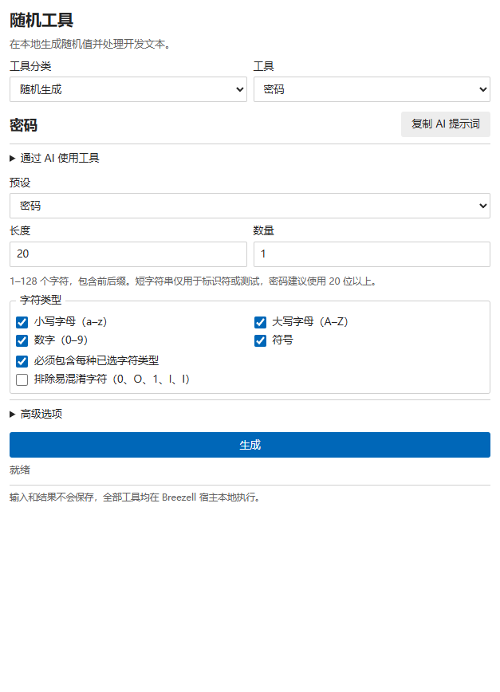

# Breezell 随机工具

简洁的本地面板，提供密码、密钥、候选端口、UUID、Hash、时间戳、Base64、URL 解析与 JWT 解码九项工具。功能参考 [LDDGO](https://www.lddgo.net/string/randompassword)、[JWT Secret Key Generator](https://jwtsecretkeygenerator.com/) 和 [IT Tools](https://ittoolshq.com/random-port)，不嵌入这些网站，也不调用它们的服务。

[English](https://github.com/cn-maomao/breezell-random-tools#readme) · [源码](https://github.com/cn-maomao/breezell-random-tools) · [安装包](https://github.com/cn-maomao/breezell-random-tools/releases) · [反馈问题](https://github.com/cn-maomao/breezell-random-tools/issues) · [版本日志](https://github.com/cn-maomao/breezell-random-tools/blob/main/CHANGELOG.md) · [MIT 许可证](https://github.com/cn-maomao/breezell-random-tools/blob/main/LICENSE)

当前版本 **0.4.0**，插件 ID 为 `cn-maomao.random-tools`，作者与发布者为 `cn-maomao`。这是社区插件，不是 Breezell 官方插件。公开 GitHub 仓库或发布安装包，不代表已获市场审核或完成上架。

## 功能

顶部使用「工具分类」与「工具」两个下拉框，先选分类，再选该分类中的工具。



截图为真实插件资源的本地浏览器预览，原生状态栏快捷入口位于面板之外。

| 分类 | 工具 |
|---|---|
| 随机生成 | 密码、密钥、端口、UUID |
| 编码与安全 | Hash、Base64、JWT 解码 |
| 解析与时间 | URL、时间戳 |

- **密码：**长度 1–128（包含固定前后缀），默认 20；支持范围长度、大小写、数字、自定义特殊字符、附加字符、排除字符、仅使用自定义字符集、排除易混淆字符，以及每类至少一个。字符集为无空白的可打印 ASCII，重复输入字符不增加权重。批量 1–100 条，同批去重。短字符串用于标识符或测试，不作为安全密码推荐。
- **用户名预设：**小写字母和数字，首位字母；不注册账户，不保证可注册。
- **密钥：**Base64URL、Base64、Hex 编码；HS256/HS384/HS512 至少使用 32/48/64 个随机字节，通用模式 16–128 字节。不签发第三方 API Key、不创建 JWT Token 或非对称公私钥对。位数来自随机字节，编码不增加随机性。
- **端口：**自定义或场景范围、常见服务端口排除、例如 `3000,8080,9000-9010` 的自定义排除，以及无重复批量生成。仅生成**候选端口**，不扫描、不监听、不保证未占用。内置清单不是完整的 IANA 注册表，场景范围不是行业标准，实际占用及系统限制需在目标主机确认。
- **UUID：**安全随机 UUID v4，标准／无连字符格式、大小写、1–100 条批量去重；不作为密码。
- **Hash：**UTF-8 文本的 SHA-256、SHA-512、SHA-1、MD5 摘要，Hex／Base64 输出。MD5 和 SHA-1 仅用于兼容校验，不用于密码存储或安全敏感验证。
- **时间戳：**秒／毫秒与 UTC 日期双向转换，日期必须使用带时区的 ISO 8601 格式；非法日期拒绝而非归一化。不接受小数 Unix 秒，毫秒转秒采用向下取整。
- **Base64：**UTF-8 或十六进制字节与标准 Base64／Base64URL 双向转换，严格检查编码及 UTF-8；编码不等于加密，不上传文件。
- **URL：**仅解析绝对 HTTP(S) 地址，保留重复查询参数，不访问、不生成可点击链接；地址中的凭据可能出现在默认隐藏的结果中。
- **JWT：**本地解码三段 JWS 的头部与声明，始终明确未验签；不判定授权／有效性，不解密 JWE，不执行输入中声明的算法。空签名可解码但永不标记为已验证。
- 支持英语和简体中文，其他语言回退英语。

## 安装与使用

1. 在 [v0.4.0 GitHub Release](https://github.com/cn-maomao/breezell-random-tools/releases/tag/v0.4.0) 下载 `cn-maomao.random-tools-0.4.0.vsix`；未提供附件时也可按下方开发步骤本地打包。
2. 如果安装过旧的 `local-tools.random-tools`，请先卸载旧插件。发布者更换后插件 ID 不同，新包不会作为旧 ID 的原位升级；同时保留可能出现重复命令和状态栏入口。
3. 在 Breezell 的插件管理中安装本地 VSIX，并登录 Breezell。
4. 点击右下角状态栏中带钥匙图标的「随机工具」。也可通过插件「打开」入口、Box 侧栏或命令面板中的「随机工具：打开」启动。选择分类及工具后运行，修改配置不会自动替换旧结果，复制始终由用户主动触发。

市场安装须等市场 PR 审核并合并后才可用；GitHub Release 与 Breezell 市场上架是两个不同流程。

## 与 AI 配合使用

顶部「复制 AI 提示词」会为当前工具生成中英文调用模板。仅点击时写入剪贴板，**必须由你主动粘贴到会话中**；插件不会自动发消息，也不会读取聊天、编辑器或剪贴板内容。

模板只复制经过校验的公开数值、布尔值及枚举选项。输入文本、令牌、结果、前后缀、自由字符集和自由端口排除文本均不复制；文本工具使用非敏感占位符。密码模板使用内置字符默认值并将 `customOnly` 设为 `false`，因此不复现自定义字符集。

需启用 `agent.tools` 权限，并按宿主要求批准调用。九项工具通过宿主本地注册，在清单中声明支持 `chat`、`agent`、`entanglement`，MCP 服务器名为 `plugin:cn-maomao.random-tools`；不启动外部 MCP 进程，也不连接外部 MCP 服务。

| 工具名 | 用途 | 模型可见的结果 |
|---|---|---|
| `rt_password` | 密码或用户名样式字符串 | 仅元数据与面板提示；包括用户名模式在内，生成值不返回模型 |
| `rt_key` | JWT HMAC 或通用随机密钥 | 仅元数据与面板提示；生成密钥不返回模型 |
| `rt_port` | 候选端口 | 端口数值与元数据，不验证占用 |
| `rt_uuid` | UUID v4 | UUID 数值与元数据 |
| `rt_hash` | 非敏感文本摘要 | 摘要与元数据；输入也进入模型会话 |
| `rt_timestamp` | 时间戳／ISO 日期转换 | 转换结果与元数据；输入也进入模型会话 |
| `rt_base64` | 非敏感文本或字节编解码 | 转换内容与元数据；输入也进入模型会话 |
| `rt_url` | 非敏感 HTTP(S) 地址解析 | 解析字段与元数据，包含地址中的用户信息；输入也进入模型会话 |
| `rt_jwt` | 示例 JWS 解码 | 头部／声明、`signatureVerified=false` 与元数据；输入令牌也进入模型会话 |

**本地执行不等于对模型保密。** 所有 AI 工具参数都会进入模型会话，包括你自行传入的字符规则与前后缀；除生成的密码／密钥值外，工具结果也会进入会话，可能发送给所配置的模型服务。不要通过 AI 工具提交真实认证令牌、密码、私密 URL 或其他敏感数据。如需不进入模型会话的本地处理，使用普通面板。拒绝工具权限或注册不可用时，手动面板仍可使用，但须满足宿主登录及插件策略。

## 安全与隐私

唯一声明的 Breezell 权限是 `agent.tools`，用于可选的 AI 工具注册，受用户审批。不申请聊天读写、模型提供者、编辑器读取或 UI 修改权限，不要求输入登录凭据或 API Key。

普通面板的生成与转换在 Breezell 宿主中本地执行；插件本身无运行时网络请求、遥测、外部进程、文件导出或历史存储，资源本地打包，Webview CSP 禁止外部连接与脚本。AI 调用的数据路径如上，不能将其描述成所有输入输出都不离开电脑。密码、密钥与 Hash／Base64／URL／JWT 结果默认隐藏，只有点击复制才写入系统剪贴板。系统剪贴板历史、同步服务或其他程序可能保留内容，本插件不会自动清空你的剪贴板。

普通面板的输入／结果，以及 AI 生成的密码／密钥值，只在当前面板与扩展内存中保存，不由插件持久化。关闭、重载、切换工具或清空会释放结果；隐藏面板后会释放渲染器并立即清除宿主中的结果引用。不写入日志、磁盘、配置、浏览器存储或 Webview 状态。工具切换、清空或退出登录时清除文本工具的输入，不保留令牌或 URL 凭据。JavaScript 无法保证物理内存被可靠擦除。

使用 Node.js 密码学安全随机源，无取模偏差。必选字符类型通过有界拒绝采样满足，冲突或过于苛刻的配置明确报错，不暗中降低规则。JWT 应用需明确是直接使用编码字符串，还是先解码为原始字节，签名和验证两端必须一致。

## 资源占用

启动时注册命令、状态栏入口与本地 AI 工具处理器；打开面板或 AI 生成的密码／密钥需要显示时才创建 Webview，无后台定时器、轮询、工作线程或持久缓存。密码使用请求内 4 KiB 安全随机缓冲和无偏拒绝采样，长度范围复用类别计数；每请求最多 10000 个候选、256 KiB 随机输入，预算耗尽明确报错，不返回部分结果。随机字节缓冲用后清零，但不宣称 JavaScript 字符串可可靠擦除。批量结果的显示／隐藏只更新当前行，关闭面板释放事件订阅。

转换输入最大 64 KiB UTF-8，输出最大 128 KiB，不增加运行时依赖。0.4.0 的安装包名称为 `cn-maomao.random-tools-0.4.0.vsix`；新增的 `agent.tools` 权限仅用于 AI 接入。

## 开发与打包

开发使用 Node.js 18.19 或更新版本；普通插件用户无需安装 Node.js。

```sh
npm install
npm run typecheck
npm run validate
npm test
npm run build
npm run package:open
```

在 Breezell 打开此文件夹，F5 启动开发窗口并登录后测试。项目包含启动任务；核心逻辑位于 `src/generator.ts`，本地转换在 `src/utilities.ts`，扩展接入在 `src/extension.ts`，工具注册在 `src/agent-tools.ts`，公开提示词模板在 `src/prompts.ts`，界面位于 `media/`。测试覆盖生成、转换、清单与工具注册、提示词排除私密数据、扩展消息边界及面板行为，临时产物由测试工具自动清理。

发布前仍需真实宿主验收：权限批准／拒绝、九项工具操作、密码与密钥仅交付面板、主动复制、深浅主题、键盘、窄窗口、WSL/SSH、隐藏／关闭、退出登录以及禁用／封禁。上述命令不代表这些宿主验收已经完成，尤其真实剪贴板与远程窗口行为仍需测试。

## Breezell 市场上架

市场卡片和插件详情由 `package.json`、图标、英文 `README.md` 及简体中文 `i18n/README.zh-CN.md` 提供，由官方 Devkit 复制并生成市场元数据；不是另建一个冒充 Breezell 市场的外部详情站。发布者、作者、0.4.0 版本号、MIT 许可证与真实 HTTPS 源码仓库已写入当前清单，但不代表市场 PR 已完成。

1. 完成自动检查与真实宿主验收，使用 `npm run package:open` 打包并本地安装验证。
2. Fork [BreezellCode/BreezellCode](https://github.com/BreezellCode/BreezellCode)；如果使用 `cn-maomao` 账户创建 Fork，再克隆 `https://github.com/cn-maomao/BreezellCode.git`。这些步骤需实际执行，不声称 Fork 已存在。从上游 `main` 创建功能分支。
3. 在插件项目执行 `npm run submit -- --market <市场克隆仓库根目录>`，不要传 `plugins` 子目录。Devkit 自动复制 VSIX、英文／中文 README 与图标，计算 SHA-256 和大小，更新 `plugins/packages/cn-maomao.random-tools/plugin.json` 并重新生成 `plugins/index.json`，不要手改校验值。
4. 在市场克隆仓库仅审阅、提交 `plugins/packages/cn-maomao.random-tools/` 与 `plugins/index.json`，推送功能分支，向上游 `main` 创建 PR。CI 通过且维护者审核合并后才完成上架；GitHub Release 不等于市场发布。
5. 已发布版本内容不可改；更新必须提升版本、重新打包并提交。不得绕过宿主审批或封禁，分发本地 VSIX 也不能让被封禁的插件运行。

构建本项目不修改市场索引，不执行 Git 提交、推送或上传。完整命令与检查清单见[中文上架指南](https://github.com/cn-maomao/breezell-random-tools/blob/main/docs/publishing.zh-CN.md)；规则以[官方发布说明](https://github.com/BreezellCode/BreezellCode/blob/main/plugins/docs/publishing.md)为准。
